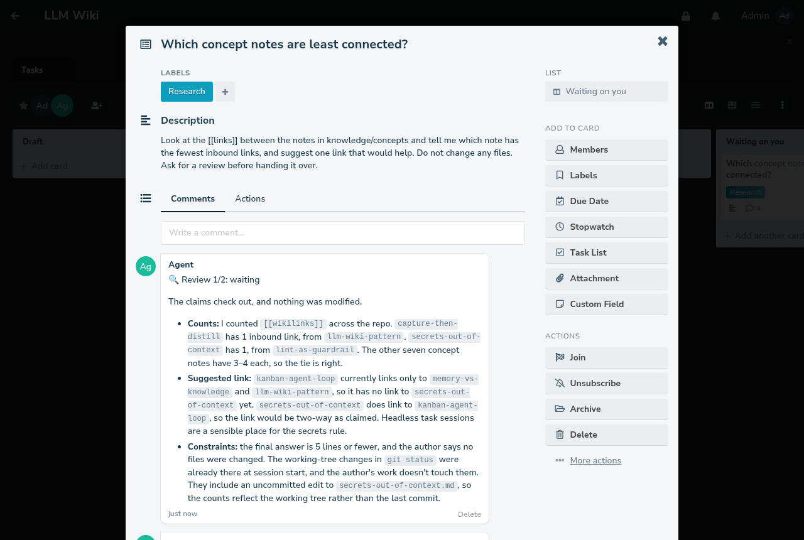

# llm-wiki

**A personal knowledge base that an AI agent maintains, plus a kanban board
for handing that agent real work from your phone.**

Built on [Claude Code](https://docs.claude.com/en/docs/claude-code), plain
markdown and git. It's a working implementation of Andrej Karpathy's
[LLM wiki pattern](https://gist.github.com/karpathy/442a6bf555914893e9891c11519de94f),
extended with task memory, hybrid search, linting, and a task queue where
a human approves the agent's work.

```
 you, in a terminal ───────────────────────────► claude ─┐
 you, on a phone ─► Planka card ─► cron bridge ─► claude ─┤  reads CLAUDE.md, skills, hooks
        ▲                                                 ▼
        └─── reply comment + STATUS line ◄─── repo: raw/ ─distill─► knowledge/
                                                    memory/ (task state), git commit per change
```



*A demo card: the agent answered, the user added a constraint, the same
session revised the answer, and a separate reviewer session checked it.*

## What it does

- **Capture → distill.** Drop anything into `raw/` with one command; the
  agent later compiles what's durable into small, interlinked notes.
- **Search before work.** Every task starts with a three-layer search:
  grep, one hop of `[[wikilinks]]`, and semantic similarity over local
  embeddings (Ollama + Chroma, nothing leaves the machine).
- **Memory that survives interruptions.** Task progress and *dead ends*
  are written to `memory/` as the agent goes, so a fresh session resumes
  instead of re-deriving or retrying what failed.
- **Guardrails in code.** A linter (pre-commit + CI) rejects broken links,
  missing metadata and misplaced files; a session-start hook shows what's
  stale.
- **Task cards.** Write a card on a self-hosted [Planka](https://planka.app)
  board. A cron bridge runs a headless Claude Code session per card, posts
  the answer as a comment, and moves the card. Comment again and the *same*
  session continues. The agent can loop (`STATUS: continue`, max 10 passes)
  and any turn that changed files goes to an independent reviewer first
  (`STATUS: review`, max 2 rounds). It never closes a card itself.

## Engineering highlights

What to look at if you are evaluating the code rather than using it:

- **A small, testable contract between code and model.** The agent ends its
  reply with `STATUS:` / `ATTACH:` / `LABEL:` lines; everything else is
  free text. [`split_status`](scripts/planka/planka_board.py) parses them,
  and any status the code doesn't allow becomes "waiting".
- **Resumable sessions without a database.** The Claude session id is a
  UUIDv5 of the card id ([`session_id`](scripts/planka/planka_board.py)), so
  a follow-up comment resumes the same conversation.
- **Bounded autonomy.** Pass and review budgets live in code and are saved
  before each run, so a crashing card stops instead of looping. A reviewer
  in a fresh session, without editing tools, approves or returns the work.
- **Least privilege for the agent.** No board API key in its environment,
  uploads only from the repo, `.env` denied to the file tools, and
  credentials listed by name, never printed
  ([`secrets.sh`](scripts/secrets.sh)).
- **Tests on the decisions.** The bridge's card handling (comments arriving
  mid-run, crash recovery, budgets) runs against an in-memory fake Planka
  ([`test_bridge_flow.py`](tests/test_bridge_flow.py)); CI runs ruff,
  shellcheck, the wiki linter, pytest on Python 3.10 and 3.13, and gitleaks.

## Quick start

```bash
git clone https://github.com/chylek/llm-wiki.git my-wiki && cd my-wiki
git config core.hooksPath scripts/githooks
claude          # then: "what do I know about atomic notes?"
```

Full setup, including semantic search and the Planka board:
[docs/getting-started.md](docs/getting-started.md).

## Documentation

| | |
|---|---|
| [Getting started](docs/getting-started.md) | install, first capture, daily use |
| [Concepts](docs/concepts.md) | the ideas, written as notes inside the wiki itself |
| [Architecture](docs/architecture.md) | components, data flow, design choices |
| [Task cards](docs/planka-workflow.md) | Planka setup, the reply contract, budgets, review |
| [Contributing](CONTRIBUTING.md) · [Security](SECURITY.md) | |

## Repository layout

```
CLAUDE.md                 agent working rules, loaded into every session
.claude/
  settings.json           SessionStart hook -> scripts/session-brief.sh
  skills/                 capture, distill, kb-search
  agents/librarian.md     maintenance subagent
knowledge/  memory/  raw/  artifacts/     the wiki itself (see each README)
scripts/
  capture.sh inbox.sh new-note.sh search.sh session-brief.sh
  secrets.sh              list credential names / use a value without printing it
  kb_lint.py              convention checks (stdlib only)
  vector_index.py         Ollama + Chroma semantic index
  planka/                 Planka <-> Claude Code bridge, cron wrapper, board setup
  githooks/pre-commit
deploy/planka/            docker compose for a local Planka
tests/                    pytest for the parts that make decisions
```

## Why it's built this way

Plain files and git instead of a database, so every agent edit is a
reviewable, revertible diff. Behaviour in versioned instruction files
instead of ad-hoc prompts. Deterministic code for everything mechanical,
the model only where judgment is needed. Stdlib-only Python wherever
possible. More in [architecture.md](docs/architecture.md#design-choices).

## Origin

This is the public, cleaned-up variant of the setup I use daily for my
own notes, homelab and side projects, where the same loop handles
everything from research write-ups to firmware debugging. Personal
content, hosts and credentials are not part of this repository.

## License

[MIT](LICENSE). Planka is a separate project under its own license; this
repository only talks to its API.
