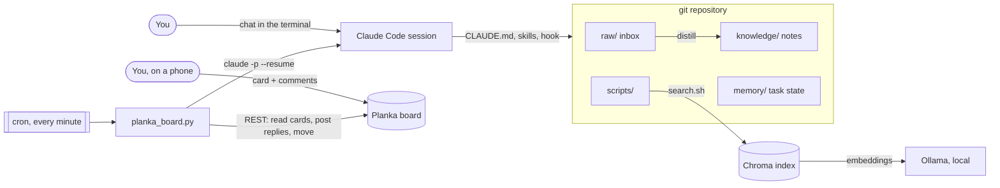

# Architecture

## Components

| Piece | Where | Role |
|---|---|---|
| Agent instructions | `CLAUDE.md` | the working rules: search first, write down as you go, commit |
| Session brief | `scripts/session-brief.sh` via `.claude/settings.json` | injects active tasks, lint state and inbox count at session start |
| Skills | `.claude/skills/` | `capture`, `distill`, `kb-search`: reusable procedures the agent loads on demand |
| Subagent | `.claude/agents/librarian.md` | a maintenance pass with its own context and a restricted toolset |
| Search | `scripts/search.sh`, `scripts/vector_index.py` | lexical + link graph + semantic, see [hybrid search](../knowledge/concepts/hybrid-search.md) |
| Lint | `scripts/kb_lint.py`, `scripts/githooks/pre-commit`, CI | keeps agent edits within the conventions |
| Task bridge | `scripts/planka/` | turns board cards into resumable agent sessions |

## Design choices

**Plain files + git as the database.** Markdown is readable by people, any
editor and any model; git gives history, diffs, blame and revert for every
agent edit, so an agent's change is reviewed and reverted like a
colleague's. There is no server or schema to maintain.

**Instructions in files, not prompts.** Behaviour lives in `CLAUDE.md`,
skills and the agent definition, versioned with the content they act on.
Improving the workflow is a commit.

**Deterministic glue, model judgment.** Everything mechanical (finding
cards, locking, counting passes, parsing `STATUS:` lines, linting) is plain
code with tests. The model is used only where judgment is needed: what a
capture means, how to do the task, whether the result is right. The
contract between the two is a few machine-readable trailer lines.

**Stdlib first.** Only semantic search has dependencies (Chroma,
requests). The linter and the bridge run on a bare Python, so the tools
that detect breakage can't be broken by a bad virtualenv.

**Optional parts fail quietly, required parts fail loudly.** A missing
embedding service drops one search layer and a failed progress comment is
ignored. A missing API key stops the bridge with a clear message, and a
crashed run is reported on the card and handed back to you instead of being
retried every minute.

**Limits in code where possible, rules in prompts where not.** Enforced by
the bridge: the agent's reply can't move a card to Done/Parked, pass and
review counts are capped, `ATTACH:` only uploads files from the repo or the
temp dir, and the agent's environment doesn't contain the board API key.
Only instructions (`CLAUDE.md`): don't push, don't send messages. The agent
has a shell, so instructions are not a sandbox; see [SECURITY.md](../SECURITY.md).

## Data flow of one card

1. You create a card in **Inbox** (or comment on any card that's waiting).
2. The cron dispatcher sees it, checks that no worker holds the card's lock,
   and spawns a detached worker (at most three run at once).
3. The worker locks the card, moves it to **Working**, downloads new
   attachments, and builds a prompt: the card on the first run, only the new
   comments on later runs (the session already holds the rest).
4. `claude -p` runs in the repo with `--session-id` (first run) or
   `--resume` (later), streaming tool calls into a live progress comment.
5. The final message is parsed: trailer lines are stripped, `ATTACH:` files
   are uploaded, `LABEL:` is applied, the text is posted as a comment, and
   `STATUS:` decides the next list.
6. `continue` → back to step 3 next minute. `review` → a fresh reviewer
   session posts findings and either returns the card to you or sends it
   back to the author with notes.
